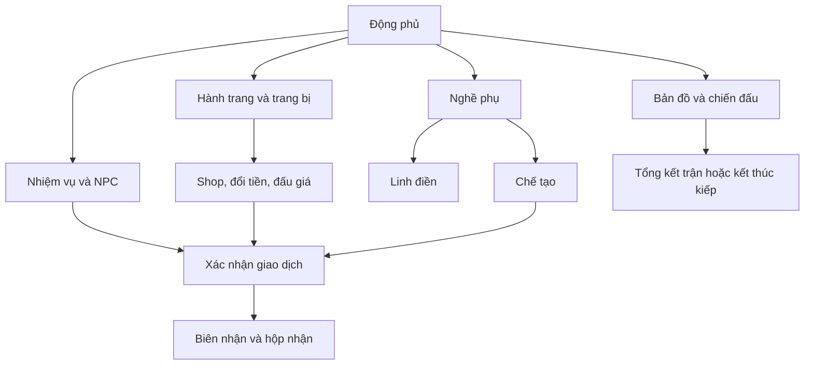

# Luồng màn hình cho client

ui_flows.json định19 màn hình với trường hiển thị, thao tác, chuyển màn và trạng thái loading/empty/ready/pending/error/recovered. Đây là hợp đồng UX cho client, không phải website đã triển khai.

## Điều hướng chính

Trên điện thoại giữ5 tab: Động phủ, Bản đồ, Nhiệm vụ, Nghề, Túi. Shop/đấu giá ở Bản đồ và lối tắt ví; NPC mở từ node/nhiệm vụ. Mỗi màn một hành động chính rõ ràng, phần còn lại là thao tác phụ. Hiển thị tên đầy đủ của tiền; mã LT_HP/LT_TP chỉ dùng ở debug dev.

## Luồng xác nhận

Người chơi chọn hành động→client xin quote→server trả tổng tiền/vật tư/tỷ lệ/hiệu ứng, expiry và version→người chơi xác nhận→một mutation có Idempotency-Key→receipt. Quote hết hạn hoặc version đổi thì hiện lại giá và cần xác nhận mới. Thiếu đúng đồng tiền có nút sang Đổi tiền; không tự đổi để hoàn giao dịch.

Pending sau mất mạng giữ request_id và tra operation; không hiện nút mới sinh một giao dịch thứ hai. Lần bấm lại cùng request trả biên nhận cũ. Cảnh báo lethal và Quy Phàm dùng màn xác nhận riêng, ghi tài sản có thể mất; không đặt nút nguy hiểm sát nút đóng.

## Linh điền

Lưới4×4 không cuộn ngang; mỗi ô hiển thị khóa/giá/cảnh giới hoặc cây/thời gian/sâu/chăm sóc. Ô khóa vẫn xem được điều kiện mua. Gieo chọn hạt hợp lệ, chăm sóc vô hiệu nếu đã dùng hoặc chưa có sâu. Thu khi túi đầy báo thiếu chỗ và giữ cây READY. Bulk action gửi từng thao tác có idempotency riêng và hiển thị kết quả từng ô, không tuyên bố cả lô thành công khi một ô lỗi.

## Chế tạo

Ba ô nguyên liệu nằm cạnh nhau, một ô catalyst tách bằng nhãn Tăng phẩm chất. Hai tỷ lệ tách rõ: “luyện thành” và “phẩm chất sau khi luyện thành”. Vẽ phù hiển thị cả tỷ lệ hỏng tăng theo cấp và số lượt ngày còn lại. Chọn công thức tự điền đủ số lượng hợp lệ, không rút đồ equipment/escrow. Job chạy qua offline; output đầy túi vào hộp nhận đúng kiếp.

## Đấu giá

Tách tab tiền, lọc item/quality/giá/giờ còn lại. Mọi lô ghi tổng giá và đơn giá. Màn bid ghi khoản mới giữ thêm, tiền đã giữ và trường hợp bị vượt giá được hoàn. Thời gian cuối cập nhật từ server, có hiển thị gia hạn chống đặt sát giờ. Lịch sử ví liên kết receipt, không dùng thông báo như bằng chứng giao dịch.

## Kiếp mới và kết cục

Màn kết thúc kiếp phân rõ thứ mất/thứ giữ, nguyên nhân và thời điểm server xử lý. Chỉ cho tạo đời mới khi giao dịch chết đã đóng; không cấp lại quà khởi đầu vì reload. Điểm/ngày đã dùng còn bị khóa theo tài khoản. Quy Phàm có ba bước: xem giá→chọn remain/defer/return_home→xác nhận cuối nếu return_home; không dùng cờ hội thoại để chọn thay người chơi.
